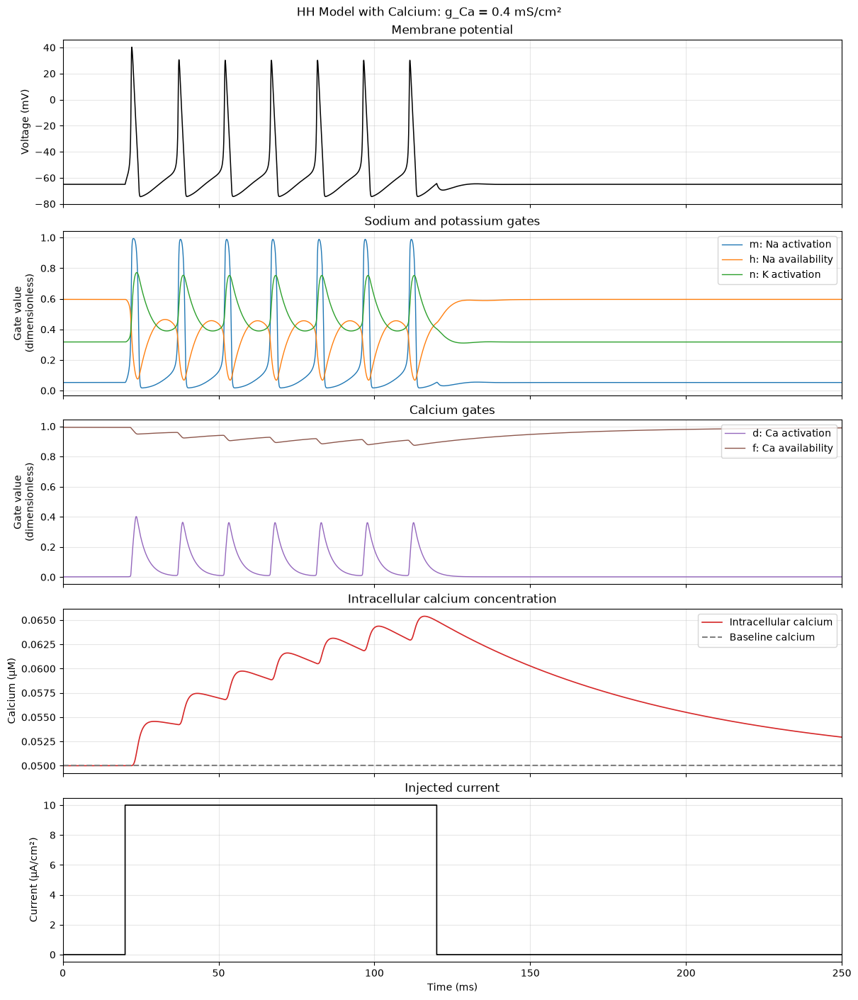
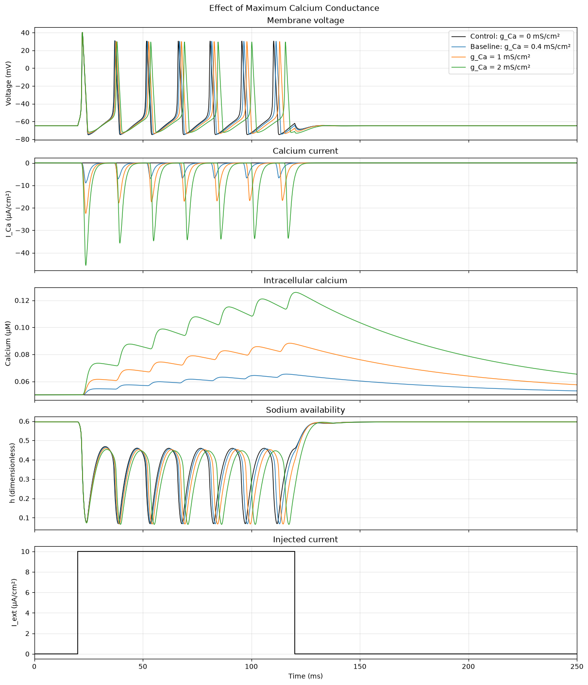

# Hodgkin–Huxley Dynamics with a Voltage-Gated Calcium Current

*Project 2 · Computational Neuroscience Independent Study*

In this project, I asked a simple question: **what changes if I add a calcium current to the Hodgkin–Huxley model?**

I wanted to look at two things: how the voltage response changes, and how calcium builds up inside the cell. I compared the model without calcium current against three versions with different maximum calcium conductances.

[Open the notebook](hodgkin_huxley_calcium.ipynb) to see the full explanation, code, plots, and results.

## What I added

The starting model has sodium, potassium, and leak currents. I kept those and added a simplified voltage-gated calcium current. Its size depends on the maximum conductance, the calcium gates, and the difference between voltage and the calcium reversal potential.

I also added an equation to track calcium concentration inside the cell. Calcium enters through the current, while another term brings the concentration back toward a baseline. So, if calcium keeps entering faster than that return term removes it, the concentration builds up.

The model tracks seven variables: voltage, three sodium and potassium gates, two calcium gates, and intracellular calcium. The [notebook](hodgkin_huxley_calcium.ipynb) explains each equation and parameter.

## What I compared

I used maximum calcium conductances of **0, 0.4, 1, and 2 mS/cm²**. Zero is the control without calcium current. Every run starts from the same state and receives the same current pulse.

Each simulation lasts 250 ms. The current is 10 µA/cm² from 20 ms up to, but not including, 120 ms. I used SciPy's `solve_ivp` with LSODA, a relative tolerance of `1e-7`, and an absolute tolerance of `1e-9`.

The saved time points are 0.01 ms apart. The solver chooses its own internal steps, so that spacing tells us how often results are saved, not how large every solver step is.

## What happened?

The clearest change was in calcium buildup. Increasing calcium conductance raised the peak calcium concentration. The first spike also became a little wider and its peak voltage increased slightly. Its measured latency stayed the same at this output spacing.

| g_Ca (mS/cm²) | Peak V (mV) | First spike width (ms) | Peak intracellular Ca (µM) | Latency (ms) |
| --- | --- | --- | --- | --- |
| 0.0000 | 40.2670 | 1.4719 | 0.0500 | 2.1400 |
| 0.4000 | 40.2770 | 1.4777 | 0.0654 | 2.1400 |
| 1.0000 | 40.2920 | 1.4866 | 0.0882 | 2.1400 |
| 2.0000 | 40.3171 | 1.5021 | 0.1259 | 2.1400 |

These values were checked by running the code again from the beginning. They match the tables saved in the original notebook at the precision shown. The [full measurement table](results/response_measurements.csv) is included too.

For these runs, the results do not show an earlier first spike with more calcium conductance. They also do not tell us whether the neuron would need less injected current to spike, because that would require a different comparison.

### Baseline response

This figure shows the voltage, gates, calcium concentration, and current pulse for the baseline calcium conductance of 0.4 mS/cm².



### Comparing the four conductances

Here, each color represents one conductance. The plots let us compare voltage, calcium current, calcium concentration, and sodium availability under the same stimulus.



## How I measured the responses

I counted a voltage peak as a spike if it was above 0 mV and had a prominence of at least 35 mV. Prominence measures how much the peak stands out from the surrounding trace.

For the first spike, I measured width at half-height using the average voltage from 15 to 20 ms as the reference. Latency is the time from the start of the current pulse to the first spike's peak. Peak calcium is the highest concentration during the full simulation.

I also looked for a separate voltage hump after the first spike. My rule did not find one in any of these runs, so the afterdepolarization measurement is `NaN`. That means the rule did not produce a measurement, not that the value is zero. The notebook gives the exact search rule.

## Would the model return to rest after a small disturbance?

I also looked for equilibria with no injected current. At an equilibrium, all seven variables stop changing. I found the voltage where the currents balance using `brentq`, then calculated the full equilibrium state.

Next, I calculated the Jacobian and its eigenvalues to check what happens near that state. For each conductance, the search found one equilibrium in the tested range, and all eigenvalues had negative real parts. This means small enough disturbances decay near those equilibria. It does not mean a larger current pulse cannot make the model spike.

The [equilibrium values](results/equilibria.csv) and [eigenvalues](results/eigenvalues.csv) are saved separately if you want to look at the numbers.

## What this model leaves out

The calcium parameters are examples, not values fitted to a particular type of neuron. The calcium reversal potential stays fixed, and the calcium concentration does not feed back into the voltage or gates. That is an important limit when interpreting the calcium buildup.

The model also treats the cell as one compartment and does not track sodium or potassium concentrations or detailed calcium handling.

There are numerical limits too. The common starting state is not necessarily an equilibrium for every calcium conductance. The equilibrium search covers a finite voltage range and can miss roots without a sign change. The execution checks do not include a convergence study or experimental validation.

## Run it yourself

You do not need an external dataset or another project notebook. The checked environment used Python 3.14.6 on macOS with Apple silicon. The exact package versions are in [requirements.txt](../requirements.txt). Other environments have not been tested. SciPy needs to include `scipy.differentiate.jacobian` for the stability section.

From the main repository folder:

```bash
python -m venv .venv
source .venv/bin/activate
python -m pip install -r requirements.txt
python -m ipykernel install --user --name portfolio --display-name "Portfolio Python"
python -m jupyter lab
```

Open `02-hodgkin-huxley-calcium/hodgkin_huxley_calcium.ipynb`, select **Portfolio Python**, and run all cells in order. Windows users can activate the environment with `.venv\Scripts\activate`.

To execute a separate copy without opening the editor, run from the repository root:

```bash
python -m jupyter nbconvert --to notebook --execute --ExecutePreprocessor.kernel_name=portfolio --ExecutePreprocessor.timeout=180 --output hodgkin_huxley_calcium_rerun 02-hodgkin-huxley-calcium/hodgkin_huxley_calcium.ipynb
```

Running the notebook displays the tables and plots. It also saves `project_2_baseline.png` and `project_2_calcium_conductance_comparison.png` in its working folder. The CSV files in `results/` were exported during the execution checks; running the original code does not export them automatically.

## About the files

The [original notebook](original/Project%202_assignment%203%20%281%29.ipynb) is kept exactly as uploaded. The version linked above adds an introduction and a clearer file name, while keeping all original cells and saved results.

The README, extracted figures, CSV files, and execution notes were added to make the project easier to read and run. You can see what was checked, and what was not, in [VERIFICATION.md](VERIFICATION.md).
