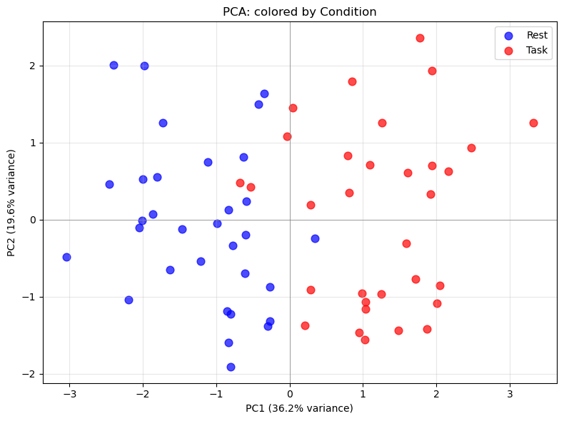
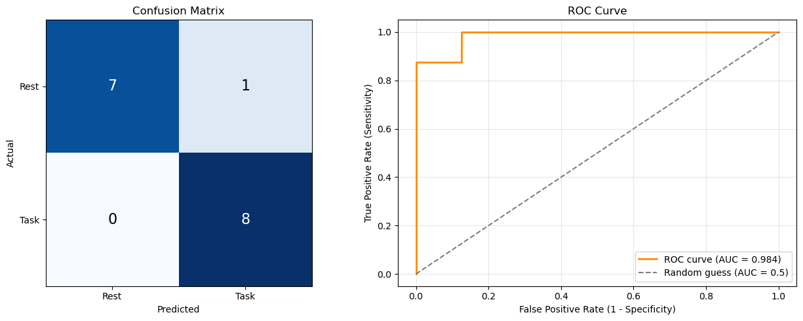
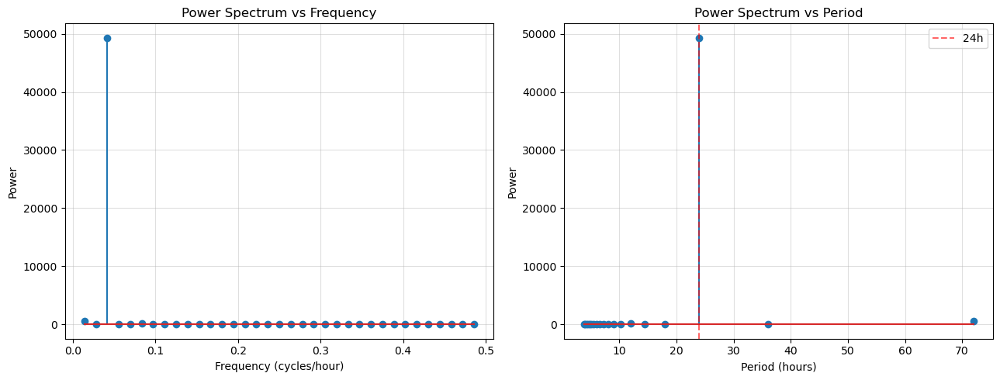

# EEG, Statistics, and Signal Analysis

*Module 2 · Computational Neuroscience Independent Study*

In this module, I wanted to see what I could learn about two conditions, **Rest and Task**, from a table of EEG features. I started with smaller exercises in descriptive statistics, regression, and frequency analysis. Then I used those ideas to compare the EEG features across channels and brain regions.

[Open the EEG notebook](06_eeg_pca_and_classification.ipynb) to see the full analysis, code, and saved results.

## What I compared

The workbook has 32 channels and two rows per channel, one for each condition. Each row contains summary features, including mean voltage, power in five frequency bands, and entropy. I started from that table, so the power values were already calculated.

I first checked for missing values and unusually high mean voltages. Then I used boxplots and heatmaps to look at power across conditions and channels. To compare regions, I matched Rest and Task by channel, subtracted the Rest value from the Task value, and averaged those changes within each region. I looked at the original and standardized features in separate notebooks.

I also calculated total power, relative alpha and beta power, and the ratio (beta + gamma) / (alpha + theta). For the PCA, I used the five standardized band powers and entropy. The classifier used those six features along with brain region.

## What happened?

The centroparietal region ranked highest when I added the absolute Task minus Rest changes across the alpha, beta, and gamma bands. The first two principal components explained **55.9%** of the variance in the standardized features.



On one split, logistic regression classified **15 of 16** held-out rows correctly (accuracy 0.938, ROC AUC 0.984). The confusion matrix shows where the one error happened.



## What the EEG results can tell me

The regional ranking describes the pattern in this workbook. The classifier score is an exercise result with two limits. I standardized the feature columns before splitting the rows, so the test rows contributed to the means and standard deviations. Also, a row-level split can put observations from the same channel in both sets. To check whether the result holds for unseen channels, I would group the split by channel and fit the scaler using only the training data. The workbook does not provide participant identifiers or a recording protocol, so this analysis cannot test generalization to new people.

## The exercises leading up to EEG

| Notebook | What I worked on |
| --- | --- |
| [Descriptive statistics](01_descriptive_statistics.ipynb) | Calculated the mean, median, range, and population standard deviation. |
| [Random sequences](02_random_sequences.ipynb) | Used histograms to compare a uniform sample with examples of several distributions. |
| [Linear regression with cricket chirps](03_cricket_chirps_regression.ipynb) | Fit a line relating chirps per second to temperature. |
| [Boiling point prediction](04_boiling_point_prediction.ipynb) | Used two altitude and boiling-point values to practice linear extrapolation. |
| [Temperature regression and FFT](05_temperature_regression_and_fft.ipynb) | Compared 24-hour and 24-plus-12-hour fits and found the strongest period in the temperature series with the FFT. |
| [Exploratory EEG analysis](06_eeg_exploratory_analysis.ipynb) | Compared Rest and Task by channel, frequency band, and region before moving on to PCA and classification. |
| [EEG PCA and classification](06_eeg_pca_and_classification.ipynb) | Standardized EEG features, visualized their variation with PCA, and fit a logistic regression classifier. |

The FFT picked out a **24-hour** period as the strongest in the temperature series. Adding the 12-hour harmonic increased the in-sample R² from 0.9822 to 0.9847.



I included my [written EEG answers](reports/eeg_answers.pdf), [written temperature answers](reports/temperature_written_answers.pdf), and [statistics and machine learning slides](reports/statistics_and_ml_terminology.pptx). The [course EEG workbook](data/eeg_32ch_dataset.xlsx) contains the feature table used in the notebooks. Its acquisition or simulation details are unspecified in the supplied files.

## Run it yourself

GitHub displays the saved figures and results directly in each notebook. To run the code, download or clone the repository and open a terminal in this module's folder. I checked the notebooks with Python 3.14.6 on macOS.

```bash
python -m venv .venv
source .venv/bin/activate
python -m pip install -r requirements.txt
python -m jupyter lab
```

Open a notebook, select **Python 3**, and run the cells in order. Keep the `data/` folder next to the notebooks so the EEG file can be found. On Windows, activate the environment with `.venv\Scripts\activate`.

The [original notebooks](original/) include my earlier temperature draft, `Untitled.ipynb`. The main copies add a short introduction and use the default Python kernel. The two EEG copies use a relative path to the workbook. In the exploratory notebook, I also made the frequency-band variable name consistent so the cells run from a fresh session. I kept the original code comments and saved results. The [execution notes](VERIFICATION.md) describe the checks.
